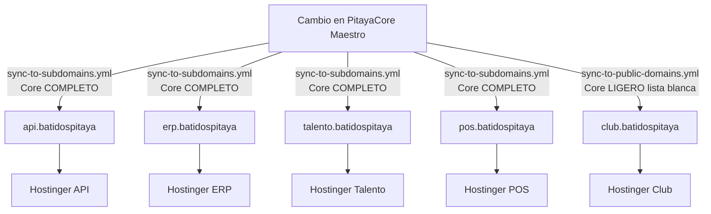

# Arquitectura PitayaCore — Mano de Hierro (v13.2)

Esta es la documentación técnica oficial del sistema de sincronización y orquestación del ecosistema **Batidos Pitaya**.

## 🛡️ Principios del Diseño: Mano de Hierro (M13)

El sistema ha sido rediseñado para garantizar la **Certeza Total al 100%**, eliminando las dependencias de señales de eventos (`repository_dispatch`) que solían ser intermitentes.

### 1. El Orquestador Central
El repositorio `PitayaCore` actúa como el **Cerebro** del sistema:
- No espera a que otros reaccionen.
- Cuando hay un cambio en el Core, `PitayaCore` entra (vía `git clone`) en cada subdominio.
- Realiza una **Inyección Directa** de archivos.
- Si la inyección en un subdominio falla (ej. por error de permisos o red), el semáforo principal se pone en **ROJO**.

### 2. Sincronización por Contenido (Checksum)
A diferencia de los sistemas de copia tradicionales, la v13.x utiliza `rsync` con el modo **Checksum (`-c`)**:
- Ignora las fechas de los archivos.
- Lee el contenido real de cada archivo para decidir si es necesario actualizarlo.
- Esto garantiza que GitHub no se "salte" archivos por errores en sus sellos de tiempo.

---

## 🚀 Flujo de Sincronización (v13.2 — Dual Channel)

---

## 📦 Tipos de Sincronización

### Canal A: Core Completo (`sync-to-subdomains.yml`)
Sincroniza **toda la carpeta `core/`** incluyendo layout, auth, permissions, helpers, components.

| Dominio | Repo | Tipo |
|---|---|---|
| `api.batidospitaya.com` | `api.batidospitaya` | ✅ Core Completo |
| `erp.batidospitaya.com` | `erp.batidospitaya` | ✅ Core Completo |
| `talento.batidospitaya.com` | `talento.batidospitaya` | ✅ Core Completo |
| `pos.batidospitaya.com` | `pos.batidospitaya` | ✅ Core Completo |

### Canal B: Core Ligero (`sync-to-public-domains.yml`)
Sincroniza **solo carpetas de la lista blanca** — seguro para dominios de acceso público.

**Carpetas que sincroniza:** `core/ai/`, `core/database/`, `core/email/`, `core/assets/`, `core/utils/`, `core/vendor/`

**Carpetas que NO sincroniza:** `core/auth/`, `core/layout/`, `core/permissions/`, `core/helpers/`, `core/components/`, `core/scripts/`, `core/wsp/`

| Dominio | Repo | Estado |
|---|---|---|
| `club.batidospitaya.com` | `club.batidospitaya` | ✅ Core Ligero (Piloto) |
| `descubre.batidospitaya.com` | `descubre.batidospitaya` | 🔜 Pendiente validación piloto |
| `ferias.batidospitaya` | `ferias.batidospitaya` | 🔜 Pendiente validación piloto |
| `pitayalove.batidospitaya` | `pitayalove.batidospitaya` | 🔜 Pendiente validación piloto |
| `planilla.batidospitaya` | `planilla.batidospitaya` | 🔜 Pendiente validación piloto |
| `posadicional.batidospitaya.com` | `posadicional.batidospitaya` | 🔜 Pendiente validación piloto |

---

## 💻 Manual de Expansión

### Agregar al Canal A (Core Completo — sistemas internos)
1. Añadir `SYNC_TOKEN` y secrets `HOSTINGER_*` al nuevo repo.
2. El `deploy-*.yml` del nuevo repo debe sincronizar `core/` y `docs/` hacia Hostinger.
3. Añadir el repo a la matriz en `sync-to-subdomains.yml`.

### Agregar al Canal B (Core Ligero — dominios públicos)
1. Añadir `SYNC_TOKEN` al nuevo repo (mismo token compartido).
2. El `deploy-*.yml` del nuevo repo sincroniza su propio contenido hacia Hostinger (ya incluye `core/` si existe).
3. Añadir el repo a la matriz en `sync-to-public-domains.yml`.
4. El dominio debe tener su propio sistema `auth_[dominio].php` (NO usar `core/auth/auth.php`).

---

## 🛠️ Comandos de Mantenimiento

- **Empuje Global**: `./.scripts/gitpush_erp.ps1` (o `gitpush_talento.ps1`, `gitpush_pos.ps1` según el repo)
- **Forzar Sync Core Completo**: `repository_dispatch` tipo `force-sync`
- **Forzar Sync Core Ligero**: `repository_dispatch` tipo `force-sync-public`
- **Revisión de Logs**: Pestaña **Actions** en GitHub (PitayaCore).
