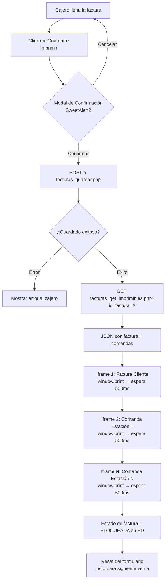

# 🖨️ Sistema de Impresión — Batidos Pitaya POS
## Lógica de Negocio, Configuración y Referencia Técnica

> **Módulo:** `modulos/pos/facturas_nueva.php` + `facturas_nueva.js`  
> **Última actualización:** Noviembre 2026 (rev. 2 — Nov 2 2026)  
> **Autor técnico:** Sistema Pitaya Web

---

## Índice

1. [Contexto General del Sistema](#1-contexto-general-del-sistema)
2. [Estructura de Base de Datos](#2-estructura-de-base-de-datos)
3. [Archivos del Sistema de Impresión](#3-archivos-del-sistema-de-impresión)
4. [Lógica de los Imprimibles](#4-lógica-de-los-imprimibles)
   - 4.1 [Factura del Cliente (Ticket 80mm)](#41-factura-del-cliente-ticket-80mm)
   - 4.2 [Comanda de Estación de Trabajo (Ticket Cocina)](#42-comanda-de-estación-de-trabajo-ticket-cocina)
5. [Flujo de Usuario](#5-flujo-de-usuario)
6. [Configuración de Impresión Silenciosa (Kiosk Printing)](#6-configuración-de-impresión-silenciosa-kiosk-printing)
   - 6.1 [Google Chrome](#61-google-chrome)
   - 6.2 [Microsoft Edge](#62-microsoft-edge)
   - 6.3 [Configurar Impresora Térmica 80mm en Windows](#63-configurar-impresora-térmica-80mm-en-windows)
   - 6.4 [Verificación](#64-verificación)
   - 6.5 [Comportamiento sin Kiosk Printing](#65-comportamiento-sin-kiosk-printing)
7. [Estructura del JSON de Imprimibles](#7-estructura-del-json-de-imprimibles)
8. [Notas Técnicas para Futuros Cambios](#8-notas-técnicas-para-futuros-cambios)

---

## 1. Contexto General del Sistema

El **Sistema POS de Batidos Pitaya** genera dos tipos de documentos imprimibles en papel térmico 80mm al momento de guardar una venta:

| Documento | Destinatario | Cantidad |
|-----------|--------------|----------|
| **Factura del Cliente** | Cajero / Cliente | 1 por venta |
| **Comanda de Estación** | Cocina / Barra | 1 por cada estación con productos en la orden |

La impresión es **secuencial y silenciosa** (sin diálogos) cuando el navegador está configurado con `--kiosk-printing`. Cada documento se envía como un trabajo independiente al spooler de Windows, lo que permite que el driver de la impresora realice el corte de papel automático entre tickets.

---

## 2. Estructura de Base de Datos

### `pos_ventas_facturas` — Cabecera de venta

| Campo | Tipo | Descripción |
|-------|------|-------------|
| `id` | INT PK | Identificador único de la factura |
| `tipo_cliente` | ENUM `'club'`\|`'general'` | Tipo de cliente |
| `id_cliente_club` | INT NULL | FK al socio Club Pitaya (si aplica) |
| `nombre_cliente_general` | VARCHAR NULL | Nombre ingresado manualmente (si tipo_cliente = 'general') |
| `subtotal` | DECIMAL | Monto sin propina |
| `propina` | DECIMAL | Monto calculado de propina |
| `porcentaje_propina` | DECIMAL | Porcentaje aplicado (ej. 2) |
| `total` | DECIMAL | Total a pagar (subtotal + propina si aplica) |
| `con_propina` | TINYINT | `1` = incluir propina, `0` = sin propina |
| `fecha_hora` | DATETIME | Fecha y hora de la transacción |
| `estado` | VARCHAR | Se marca **bloqueada** tras imprimir para evitar edición posterior |

---

### `pos_ventas_factura_lineas` — Líneas de la venta

| Campo | Tipo | Descripción |
|-------|------|-------------|
| `id_factura` | INT FK | Referencia a `pos_ventas_facturas.id` |
| `id_producto_presentacion` | INT FK | Presentación del producto |
| `nombre_producto_snapshot` | VARCHAR | Nombre del producto al momento de la venta (inmutable) |
| `cantidad` | INT | Unidades vendidas |
| `precio_unitario_snap` | DECIMAL | Precio base del producto (sin extras) |
| `precio_extras_total` | DECIMAL | Suma del precio de todos los extras agregados |
| `precio_unitario_final` | DECIMAL | Precio unitario con extras incluidos (sin × cantidad) |
| `precio_linea_total` | DECIMAL | `precio_unitario_final × cantidad` |
| `notas` | TEXT | Texto libre del cajero + resumen de personalización concatenado en formato `[Endulzante: X \| Sin: Y \| Cambio: A→B \| Extra: Z]` |

---

### `grupo_presentacion_producto` — Grupos de productos / Estaciones

| Campo | Tipo | Descripción |
|-------|------|-------------|
| `id` | INT PK | Identificador del grupo |
| `nombre` | VARCHAR | Nombre del grupo (ej. "Batidos y Limonadas") |
| `estacion_trabajo` | TINYINT | `1` = este grupo genera comanda de cocina propia |
| `lleva_endulzante` | TINYINT | `1` = los productos de este grupo usan endulzante |

**Estaciones activas con `estacion_trabajo = 1`:**

| id | Nombre |
|----|--------|
| 1 | Batidos y Limonadas |
| 2 | Bowls |
| 6 | Waffles |

> [!NOTE]
> Para añadir una nueva estación, basta con poner `estacion_trabajo = 1` en el grupo correspondiente. No requiere cambio de código.

---

### `componentes_receta_producto` — Ingredientes de receta

| Campo | Tipo | Descripción |
|-------|------|-------------|
| `nombre` | VARCHAR | Nombre del componente (ej. "Fresa", "Leche") |
| `id_presentacion_producto` | INT FK | Producto al que pertenece |
| `cantidad` | DECIMAL | Cantidad estándar de la receta |
| `tipo_comanda` | CHAR(1) NULL | Clasificación del ingrediente (ver tabla de tipos) |
| `orden_comanda` | INT NULL | Orden de aparición en la comanda. **Solo aparecen los ingredientes donde este campo es NOT NULL** |
| `notas` | TEXT | Notas adicionales del ingrediente |

**Tipos de ingrediente (`tipo_comanda`):**

| Código | Significado |
|--------|-------------|
| `B` | Base (ingrediente principal) |
| `L` | Líquido / Hielo |
| `P` | Proteína |
| `X` | Extra agregado |
| `E` | Endulzante (asignado por el sistema, **no viene de la BD**) |
| `null` | Sin clasificación — **no aparece en comanda** |

---

### `endulzantes` — Tabla de opciones de endulzante

| Campo | Tipo | Descripción |
|-------|------|-------------|
| `nombre` | VARCHAR | Nombre base del endulzante (ej. "Azucar", "Stevia", "Splenda") |
| `unidad_medida` | VARCHAR | Unidad de medida (ej. "oz", "paquete") |
| `factor` | DECIMAL | Cantidad a usar (ej. `1`, `1.5`, `0.5`, `3`) |
| `nombre_opcion` | VARCHAR | Nombre de la opción mostrada al cajero |
| `activo` | TINYINT | `1` = disponible para selección |

**Cómo se muestra en la comanda:**

```
Tipo: E
Nombre: "[nombre] [unidad_medida]"   →  ej. "Azucar oz" / "Splenda paquete"
Cantidad: [factor]                   →  ej. 1 / 1.5 / 3
```

---

### `extras` — Extras agregables a productos

| Campo | Tipo | Descripción |
|-------|------|-------------|
| `nombre` | VARCHAR | Nombre del extra (ej. "Proteína Extra") |
| `precio` | DECIMAL | Precio adicional del extra |
| `grupo` | INT FK | Grupo al que aplica el extra |

> Los extras tienen `tipo_comanda = X` en la comanda. No provienen de `producto_presentacion` sino de esta tabla separada.

---

## 3. Archivos del Sistema de Impresión

| Archivo | Propósito |
|---------|-----------|
| `modulos/pos/ajax/facturas_get_imprimibles.php` | Endpoint PHP que recibe `id_factura` (GET) y devuelve el JSON estructurado completo con todos los datos necesarios para renderizar factura y comandas |
| `modulos/pos/js/pos_impresion_termica.js` | Módulo JavaScript que construye el HTML de cada ticket, lo inyecta en iframes y orquesta la impresión secuencial |
| `modulos/pos/css/ticket_termico_80mm.css` | Estilos CSS optimizados para papel térmico 80mm (72mm imprimible), incluyendo tachados para ingredientes quitados o sustituidos |

---

## 4. Lógica de los Imprimibles

### 4.1 Factura del Cliente (Ticket 80mm)

Este ticket va dirigido al cliente y es emitido siempre, una vez por venta.

---

#### 🏷️ Cabecera

```
        [LOGO PITAYA]
   Bienvenid@ [Nombre Cliente]
Fecha: 02-Nov-26  Hora: 2:30 pm  Tienda: Villa Fontana
━━━━━━━━━━━━━━━━━━━━━━━━━━━━━━━
```

| Elemento | Origen | Formato |
|----------|--------|---------|
| Logo | `assets/img/logo_pitaya.png` | Centrado, max-width 100% |
| Nombre cliente (club) | Nombre del socio en Club Pitaya | "Bienvenid@ Juan Pérez" |
| Nombre cliente (general) | `nombre_cliente_general` | "Bienvenid@ Cliente General" |
| Fecha | `fecha_hora` | `DD-MMM-YY` (ej. 02-Nov-26) |
| Hora | `fecha_hora` | `HH:MM am/pm` (ej. 2:30 pm) |
| Tienda | Sucursal logueada en la sesión | Nombre de la sucursal |

---

#### 🛒 Cuerpo del Detalle

Tabla de productos con columnas:

| Columna | Origen | Notas |
|---------|--------|-------|
| **Producto** | `nombre_producto_snapshot` | Nombre inalterable al momento de venta |
| **Can** | `cantidad` | Unidades |
| **PU** | `precio_unitario_final` | Precio unitario **con extras**, sin × cantidad |
| **PT** | `precio_linea_total` | `PU × cantidad` |

**Personalizaciones** (listadas debajo de cada producto, con sangría):

Las personalizaciones se extraen del campo `notas` de la línea y se muestran así:

```
- Endulzante: Stevia 2 sobres
- Sin: Avena
- Cambio: Leche por Leche de Almendras
- Extra: Proteína Extra (+C$ 30.00)
- Nota: Sin hielo por favor
```

**Ítems de canje de puntos:**

```
Nombre del Producto        [CANJE PUNTOS]
  ...personalizaciones...
                    Can  PU        PT
                      1  C$ 0.00   C$ 0.00
```

---

#### 💰 Totales

```
━━━━━━━━━━━━━━━━━━━━━━━━━━━━━━━
Sub-Total:              C$ 350.00
Propina (2%):           C$   7.00    ← solo si con_propina = 1
━━━━━━━━━━━━━━━━━━━━━━━━━━━━━━━
Total a Pagar:          C$ 357.00
```

---

#### 👋 Pie de página

```
     Agradecemos su Visita
     WiFi: tubatidofavorito
```

> [!TIP]
> Para cambiar la contraseña del WiFi, editar la constante `WIFI_PASSWORD` en `pos_impresion_termica.js`.

---

### 4.2 Comanda de Estación de Trabajo (Ticket Cocina)

Se genera **un documento independiente por cada grupo** con `estacion_trabajo = 1` que tenga **al menos un producto en la orden actual**. Si la orden no tiene productos de esa estación, no se genera comanda para ella.

---

#### 🏷️ Cabecera de la Comanda

```
━━━━━━━━━━━━━━━━━━━━━━━━━━━━━━━
    **BATIDOS Y LIMONADAS**
━━━━━━━━━━━━━━━━━━━━━━━━━━━━━━━
Cliente: Juan Pérez  |  Pedido: #2222
Fecha: 02-Nov-26  Hora: 2:30 pm
━━━━━━━━━━━━━━━━━━━━━━━━━━━━━━━
```

| Elemento | Origen |
|----------|--------|
| Nombre estación | `nombre_grupo` en MAYÚSCULAS y negrita |
| Cliente | Nombre del cliente (club o general) |
| Pedido | `id` de `pos_ventas_facturas` |
| Fecha / Hora | `fecha_hora` formateado |

---

#### 🥤 Por cada producto de esta estación

**Encabezado del producto:**

```
[ 2 ]  Proteinico 20oz
```

**Si tiene notas del cajero** (texto libre antes del separador `|` en el campo `notas`):

```
┌─────────────────────────────┐
│ ⚠ Sin hielo por favor       │
└─────────────────────────────┘
```

**Tabla de ingredientes** (ordenada por `orden_comanda ASC`):

| # | Tipo | Ingrediente | Cant |
|---|------|-------------|------|
| Siempre primero si aplica | `E` | `Azucar oz` | `1` |
| Según receta | `B` | `Fresa` | `200g` |
| Quitado | ~~`L`~~ | ~~`Leche`~~ | ~~`240ml`~~ |
| Sustituido fila 1 | ~~`L`~~ | ~~`Leche`~~ | ~~`240ml`~~ |
| Sustituido fila 2 | `L` | `Leche de Almendras` | `240ml` |
| Extra | `X` | `Proteína Extra` | `1` |

**Reglas de orden de ingredientes en la comanda:**

1. **Endulzante** (si el grupo tiene `lleva_endulzante = 1`): siempre aparece primero, tipo `E`.
2. **Ingredientes de la receta base** ordenados por `orden_comanda ASC`. Solo aparecen si `orden_comanda IS NOT NULL`.
3. **Extras** agregados por el cliente: tipo `X`, al final.

**Representación visual de acciones sobre ingredientes:**

| Acción | Representación CSS |
|--------|--------------------|
| `normal` | Fila normal, sin decoración |
| `quitado` | `text-decoration: line-through; font-weight: bold;` — tachado grueso en toda la fila |
| `sustituido` | Fila 1 = original con tachado grueso; Fila 2 = nuevo ingrediente con mismo tipo y cantidad |

---

#### 📋 Sección "COMPLETAR PEDIDO CON..."

Aparece **al final de cada comanda**, solo si existen en la misma orden productos que **no pertenecen** a esta estación.

```
━━━━━━━━━━━━━━━━━━━━━━━━━━━━━━━
COMPLETAR PEDIDO CON:
━━━━━━━━━━━━━━━━━━━━━━━━━━━━━━━
Producto                       Can
Açaí Bowl Tropical               1
Coca-Cola 355ml                  2
```

Incluye todos los productos de la orden que:
- Pertenecen a **otra** estación (`estacion_trabajo = 1` de otro grupo), **o**
- **No tienen** estación asignada (`estacion_trabajo = 0` o NULL)

> [!IMPORTANT]
> Esta sección permite a la persona en la estación saber qué otros ítems componen el pedido completo, para poder entregar todo al mismo tiempo.

---

## 5. Flujo de Usuario



### Detalle de cada paso:

| Paso | Descripción |
|------|-------------|
| **1. Llenado** | Cajero ingresa productos, cantidad, personalizaciones y cliente |
| **2. Botón** | "Guardar e Imprimir" (renombrado desde "Guardar Factura") |
| **3. Confirmación** | Modal SweetAlert2: título "¿Guardar e Imprimir?", texto de advertencia sobre bloqueo, botón Sí (verde) / No (gris) |
| **4. Guardado** | POST a `facturas_guardar.php` → registra en `pos_ventas_facturas` y `pos_ventas_factura_lineas` |
| **5. Datos** | GET a `facturas_get_imprimibles.php?id_factura=X` → devuelve JSON estructurado |
| **6. Impresión** | JS inyecta cada documento en un iframe oculto y llama `window.print()` secuencialmente con 500ms de espera entre cada uno |
| **7. Corte** | Cada trabajo independiente en el spooler provoca corte automático de papel (requiere configuración del driver) |
| **8. Bloqueo** | La factura queda en estado `bloqueada` — no puede editarse |
| **9. Reset** | Formulario se limpia para nueva venta |

### Detección de modo de impresión:

El módulo `pos_impresion_termica.js` llama a `window.print()` directamente dentro de cada iframe:

- **Con `--kiosk-printing`**: imprime inmediatamente a la impresora predeterminada, sin diálogos.
- **Sin `--kiosk-printing`**: muestra el diálogo estándar del navegador. El cajero puede seleccionar la impresora manualmente. El flujo no se rompe, pero requiere un paso adicional por cada documento.

---

## 6. Configuración de Impresión Silenciosa (Kiosk Printing)

### ¿Qué es Kiosk Printing?

Es un modo de **Chrome** y **Edge** donde `window.print()` envía directamente a la impresora predeterminada **sin mostrar ningún diálogo** de selección ni vista previa. Es el modo ideal para puntos de venta donde la impresora ya está configurada y el cajero no debe ver interrupciones.

---

### Prerrequisitos

Antes de configurar el navegador, asegurarse de que:

- [x] Impresora térmica 80mm instalada en Windows con su driver correspondiente
- [x] Impresora configurada como **predeterminada del sistema**
- [x] Papel configurado: rollo continuo 80mm (72mm imprimible)
- [x] Opción **"Corte de papel"** activada en las propiedades del driver (`Document Cut` / `Auto Cut` al final de cada trabajo)

---

### 6.1 Google Chrome

1. Localizar el ejecutable de Chrome:
   ```
   C:\Program Files\Google\Chrome\Application\chrome.exe
   ```

2. Crear un acceso directo en el escritorio.

3. Click derecho sobre el acceso directo → **Propiedades**.

4. En el campo **"Destino"**, agregar los flags al final:

   ```
   "C:\Program Files\Google\Chrome\Application\chrome.exe" --kiosk-printing --app="https://pos.batidospitaya.com/modulos/pos/facturas_nueva.php"
   ```

5. Hacer clic en **Aceptar**.

> [!IMPORTANT]
> Usar **SIEMPRE** este acceso directo para abrir el POS. Si se abre Chrome normalmente (sin los flags), el kiosk printing no estará activo.

---

### 6.2 Microsoft Edge

1. Localizar el ejecutable de Edge:
   ```
   C:\Program Files (x86)\Microsoft\Edge\Application\msedge.exe
   ```

2. Crear un acceso directo en el escritorio → Click derecho → **Propiedades** → **Destino**:

   ```
   "C:\Program Files (x86)\Microsoft\Edge\Application\msedge.exe" --kiosk-printing --app="https://pos.batidospitaya.com/modulos/pos/facturas_nueva.php"
   ```

3. Hacer clic en **Aceptar**.

> [!NOTE]
> El flag `--app` abre el POS en modo aplicación (sin barra de navegación ni pestañas), ideal para puntos de venta.

---

### 6.3 Configurar Impresora Térmica 80mm en Windows

1. Ir a **Panel de Control → Dispositivos e Impresoras**.
2. Click derecho en la impresora térmica → **Preferencias de impresión**.
3. En la pestaña de papel: seleccionar tamaño `Receipt 80mm` o configurar tamaño personalizado de 80mm de ancho.
4. En opciones de corte: activar **"Auto Cut"** o **"Cortar al final del documento"**.
5. Click derecho en la impresora → **"Establecer como impresora predeterminada"**.
6. Click derecho → **Propiedades de la impresora** → pestaña **Avanzadas**: deshabilitar **"Retener documentos en cola"** si está activo.

> [!CAUTION]
> Si "Retener documentos en cola" está activo, los trabajos de impresión se acumularán sin imprimirse. Asegurarse de desactivarlo.

---

### 6.4 Verificación

Para confirmar que la configuración es correcta:

1. Abrir el POS usando el acceso directo configurado (con los flags).
2. Agregar un producto de prueba y proceder a guardar e imprimir.
3. Verificar que:
   - ✅ La impresión se dispara **sin mostrar ningún diálogo**
   - ✅ El papel se corta automáticamente al final de cada ticket
   - ✅ Se imprimen documentos separados por cada estación con productos

---

### 6.5 Comportamiento sin Kiosk Printing

Si el navegador **NO** está configurado con `--kiosk-printing`:

- Al ejecutarse `window.print()` aparecerá el **diálogo estándar del navegador**.
- El cajero puede seleccionar la impresora manualmente.
- El flujo **no se rompe**, pero requiere un paso adicional por cada documento.
- En entornos de prueba o desarrollo, este comportamiento es aceptable.

---

## 7. Estructura del JSON de Imprimibles

El endpoint `modulos/pos/ajax/facturas_get_imprimibles.php` recibe `id_factura` por GET y devuelve el siguiente JSON:

```json
{
  "success": true,
  "factura": {
    "id": 2222,
    "nombre_cliente": "Juan Pérez",
    "tipo_cliente": "club",
    "fecha_hora": "2026-11-02T14:30:00",
    "nombre_sucursal": "Villa Fontana",
    "subtotal": 350.00,
    "propina": 7.00,
    "porcentaje_propina": 2,
    "con_propina": 1,
    "total": 357.00,
    "lineas": [
      {
        "id": 1,
        "nombre_producto": "Proteinico 20oz",
        "cantidad": 1,
        "precio_unitario_final": 150.00,
        "precio_linea_total": 150.00,
        "notas": "Sin hielo por favor | [Endulzante: Stevia 2 sobres | Sin: Avena]",
        "es_canje_puntos": 0,
        "id_grupo": 1,
        "nombre_grupo": "Batidos y Limonadas",
        "estacion_trabajo": 1,
        "personalizacion": {
          "endulzante_nombre": "Stevia",
          "endulzante_factor": 2,
          "endulzante_unidad": "paquete",
          "ingredientes_quitados": [
            { "nombre_componente": "Avena" }
          ],
          "ingredientes_sustituidos": [
            {
              "nombre_original": "Leche",
              "nombre_nuevo": "Leche de Almendras",
              "tipo_comanda": "L",
              "cantidad": 1.0
            }
          ],
          "extras_agregados": [
            { "nombre": "Proteína Extra", "cantidad": 1 }
          ]
        },
        "ingredientes_receta": [
          {
            "tipo_comanda": "B",
            "nombre_componente": "Fresa",
            "cantidad": 200,
            "unidad": "g",
            "orden_comanda": 1,
            "accion": "normal"
          },
          {
            "tipo_comanda": "L",
            "nombre_componente": "Leche",
            "cantidad": 240,
            "unidad": "ml",
            "orden_comanda": 2,
            "accion": "sustituido",
            "nombre_nuevo": "Leche de Almendras"
          },
          {
            "tipo_comanda": "B",
            "nombre_componente": "Avena",
            "cantidad": 30,
            "unidad": "g",
            "orden_comanda": 3,
            "accion": "quitado"
          }
        ]
      }
    ]
  },
  "comandas": [
    {
      "id_grupo": 1,
      "nombre_grupo": "Batidos y Limonadas",
      "lleva_endulzante": 1,
      "productos": [
        {
          "nombre_producto": "Proteinico 20oz",
          "cantidad": 2,
          "notas_cajero": "Sin hielo por favor",
          "endulzante": {
            "tipo": "E",
            "nombre": "Stevia paquete",
            "factor": 2
          },
          "ingredientes": [
            { "tipo": "B", "nombre": "Fresa", "cantidad": "200g", "accion": "normal" },
            { "tipo": "L", "nombre": "Leche", "cantidad": "240ml", "accion": "sustituido", "nombre_nuevo": "Leche de Almendras" },
            { "tipo": "B", "nombre": "Avena", "cantidad": "30g", "accion": "quitado" },
            { "tipo": "X", "nombre": "Proteína Extra", "cantidad": "1" }
          ]
        }
      ],
      "completar_con": [
        { "nombre_producto": "Açaí Bowl Tropical", "cantidad": 1 },
        { "nombre_producto": "Coca-Cola 355ml", "cantidad": 2 }
      ]
    }
  ]
}
```

### Descripción de campos clave:

| Campo | Tipo | Descripción |
|-------|------|-------------|
| `factura.lineas[].personalizacion` | Object | Detalle estructurado de las personalizaciones para renderizar en la factura |
| `factura.lineas[].ingredientes_receta` | Array | Ingredientes con su acción (`normal`, `quitado`, `sustituido`) ya computada |
| `comandas[].lleva_endulzante` | Int | `1` = incluir fila de endulzante al inicio de la tabla de ingredientes |
| `comandas[].completar_con` | Array | Productos de otras estaciones o sin estación, para la sección "Completar pedido con..." |
| `factura.lineas[].es_canje_puntos` | Int | `1` = mostrar `[CANJE PUNTOS]` y PT = C$ 0.00 |

---

## 8. Notas Técnicas para Futuros Cambios

### Agregar una nueva estación de trabajo

```sql
-- Solo se necesita esto en la BD:
UPDATE grupo_presentacion_producto
SET estacion_trabajo = 1
WHERE id = <id_del_nuevo_grupo>;
```

El sistema detecta automáticamente todos los grupos con `estacion_trabajo = 1` y genera la comanda correspondiente. **No requiere cambio de código.**

---

### Cambiar el texto del WiFi en el pie de la factura

Editar la constante en `pos_impresion_termica.js`:

```javascript
// pos_impresion_termica.js
const WIFI_PASSWORD = 'tubatidofavorito'; // ← cambiar aquí
```

---

### Cambiar el logo

- **Ruta del logo:** `assets/img/logo_pitaya.png`
- Reemplazar el archivo manteniendo el mismo nombre y ruta.
- El CSS del ticket ajusta automáticamente al ancho del papel (`max-width: 100%`).
- Se recomienda un PNG con fondo transparente, orientación horizontal, y ancho mínimo de 400px para buena resolución en papel térmico.

---

### Agregar una nueva personalización a la factura

1. Asegurarse de que el nuevo tipo de personalización se guarda en el campo `notas` de `pos_ventas_factura_lineas` con el formato entre corchetes: `[NuevaTipo: valor]`.
2. En `facturas_get_imprimibles.php`, parsear el nuevo patrón y agregarlo al objeto `personalizacion` del JSON.
3. En `pos_impresion_termica.js`, agregar el renderizado de la nueva llave en el bloque de personalizaciones de la factura.

---

### Ajustar el tiempo entre impresiones

En `pos_impresion_termica.js`, buscar la constante o parámetro de espera:

```javascript
const DELAY_ENTRE_IMPRESIONES_MS = 500; // milisegundos entre cada window.print()
```

Si la impresora es lenta o el spooler se satura, aumentar este valor (ej. a `1000` o `1500`).

---

### Estructura recomendada de `ticket_termico_80mm.css`

```css
/* ===================================================
   ticket_termico_80mm.css
   Estilos para impresión en papel térmico 80mm
   Ancho imprimible: ~72mm
   =================================================== */

@page {
  size: 80mm auto;   /* ancho fijo, alto automático */
  margin: 2mm 3mm;
}

body {
  font-family: 'Courier New', Courier, monospace;
  font-size: 10pt;
  width: 72mm;
  margin: 0;
  padding: 0;
}

.logo {
  display: block;
  max-width: 100%;
  margin: 0 auto 4px;
}

.centro { text-align: center; }
.negrita { font-weight: bold; }
.mayusculas { text-transform: uppercase; }

/* Tachado grueso para ingredientes quitados o sustituidos */
.tachado {
  text-decoration: line-through;
  font-weight: bold;
  -webkit-text-decoration-line: line-through;
  text-decoration-thickness: 2px;
}

/* Recuadro para notas del cajero */
.nota-cajero {
  border: 1px solid #555;
  background-color: #f0f0f0;
  padding: 3px 5px;
  margin: 4px 0;
  font-style: italic;
}

table {
  width: 100%;
  border-collapse: collapse;
  font-size: 9pt;
}

th {
  border-bottom: 1px solid #000;
  text-align: left;
}

.separador {
  border-top: 1px dashed #000;
  margin: 4px 0;
}

@media print {
  body { width: 72mm; }
}
```

---

### Consideraciones de rendimiento y compatibilidad

| Aspecto | Recomendación |
|---------|---------------|
| **Fuente** | Usar fuente monoespaciada (`Courier New`) para alinear columnas correctamente |
| **Imágenes** | Logo en PNG ligero (< 20KB); imágenes pesadas retrasan la impresión |
| **Iframes** | Crear y destruir el iframe después de cada impresión para evitar acumulación en memoria |
| **Timeout** | 500ms entre impresiones es el mínimo; impresoras lentas pueden necesitar 1000–1500ms |
| **Driver** | Probar con el driver oficial del fabricante (Epson, Star, Bixolon, etc.); evitar drivers genéricos |
| **Papel** | Configurar el tamaño exacto en el driver para evitar márgenes extra o texto cortado |

---

*Documento generado para el equipo técnico de Batidos Pitaya · Sistema POS · `pos.batidospitaya.com`*

---

## 9. Cambios Visuales — Rev. 2 (Nov 2, 2026)

Los siguientes cambios se aplicaron en `pos_impresion_termica.js` en la revisión 2:

### 9.1 Factura — Logo reducido 10%

El ancho máximo del logo pasó de `55mm` a `50mm` (≈ −10%).

```css
/* Antes */
.ticket-logo { max-width: 55mm; }
/* Después */
.ticket-logo { max-width: 50mm; }
```

---

### 9.2 Comanda — Cabecera reestructurada

**Antes:** Cliente y Pedido en una misma fila `flex justify-content: space-between`.

**Después:** Tres líneas independientes para mayor legibilidad a distancia:

```
Línea 1: Cliente: [nombre]
Línea 2: #[número de pedido]   ← fuente 13pt, bold, destacado
Línea 3: [fecha]   [hora]
```

CSS involucrado:
```css
.comanda-meta-cliente  { font-size: 9pt; }
.comanda-meta-pedido   { font-size: 13pt; font-weight: bold; letter-spacing: 0.3mm; }
.comanda-meta-fechahora { font-size: 8pt; }
```

---

### 9.3 Comanda — Nombre de producto más grande

```css
/* Antes */
.comanda-prod-nombre { font-size: 10pt; }
/* Después */
.comanda-prod-nombre { font-size: 12pt; }
```

---

### 9.4 Comanda — Espacio después de la cabecera de datos

Se agregó `.comanda-meta-wrapper` con `margin-bottom: 3mm` para crear aire visual entre la cabecera (cliente/pedido/fecha) y el primer producto.

---

### 9.5 Comanda — Espacio entre productos

```css
/* Antes */
.comanda-producto-bloque { margin-bottom: 3mm; padding-bottom: 2mm; }
/* Después */
.comanda-producto-bloque { margin-bottom: 4mm; padding-bottom: 3mm; }
```

---

### 9.6 Comanda — Separador de grupos de ingredientes por tipo

Entre el último ingrediente de un tipo y el primero del siguiente tipo se inserta una fila separadora de media línea tenue (no una línea completa, para distinguirla del separador entre productos):

```html
<tr class="comanda-grupo-sep">
  <td colspan="3"><div class="comanda-grupo-sep-linea"></div></td>
</tr>
```

```css
.comanda-grupo-sep-linea { border-bottom: 0.5px dashed #aaa; }
```

**Lógica JS:** Se rastrea el `tipo` del ingrediente anterior; cuando cambia, se emite la fila separadora. El endulzante (`E`) también cuenta como un tipo. Los extras (`X`) también reciben un separador previo si hay ingredientes antes.

---

### 9.7 Comanda — Espacio arriba de "Completar Pedido con..."

El bloque de completar pedido usa `.comanda-completar-wrapper` con `margin-top: 4mm; padding-top: 3mm; border-top: 2px solid #000;` para separarlo visualmente del último producto.

---

### 9.8 Comanda — "Completar Pedido con..." como tabla con encabezados y checklist

**Antes:** tabla sin encabezados, sin separadores entre filas.

**Después:** tabla con encabezados (`☐ | Producto | Can`) y cada fila con un checkbox impreso (`☐`) para uso como lista de verificación manual.

```html
<thead>
  <tr>
    <th class="col-check">☐</th>
    <th>Producto</th>
    <th class="col-cant-h">Can</th>
  </tr>
</thead>
<tbody>
  <tr>
    <td class="col-check">☐</td>
    <td>Açaí Bowl Tropical</td>
    <td class="col-cant">1</td>
  </tr>
</tbody>
```

Las filas tienen `border-bottom: 0.5px dashed #ccc` para separación visual entre ítems.

---

### 9.9 Comanda — Cantidades como fracciones

Las cantidades de ingredientes se convierten de decimal a fracción antes de mostrarse.

**Fracciones soportadas:** `1/2`, `1/4`, `1/8`, `1/3`, `1/6`

**Tolerancia:** `±0.015` (para manejar redondeos de la BD como `0.3333...` o `0.1666...`)

**Función:** `decimalAFraccion(numero)` en `pos_impresion_termica.js`

| Valor BD | Mostrado |
|----------|----------|
| `4.3333` | `4+1/3` |
| `8.125`  | `8+1/8` |
| `0.5`    | `1/2`   |
| `2.25`   | `2+1/4` |
| `1.1667` | `1+1/6` |
| `3.777`  | `3.777` (sin equivalente) |

Si no hay equivalente dentro de la tolerancia, se muestra el decimal tal cual (limpiando ceros finales).

---

### 9.10 Todos los documentos — Fuente más legible

Se cambió la fuente base de `Courier New` (monoespaciada) a **`Arial / Helvetica / sans-serif`** para mejor lectura a distancia en papel térmico.

```css
/* Antes */
body { font-family: 'Courier New', Courier, monospace; }
/* Después */
body { font-family: Arial, 'Helvetica Neue', Helvetica, sans-serif; }
```

> [!NOTE]
> El cambio a sans-serif mejora la legibilidad visual pero puede afectar el alineamiento de columnas numéricas en la factura. Si se requiere alineación perfecta de decimales, evaluar usar `font-variant-numeric: tabular-nums` o volver a monoespaciada solo para las columnas de precio.

---

### Consideraciones de compatibilidad

| Aspecto | Detalle |
|---------|---------|
| **Fracciones** | Solo aplican a cantidades de ingredientes en comanda. Los totales y precios en factura siguen mostrando decimales con 2 cifras. |
| **Checklist** | El caracter `☐` (U+2610) es Unicode estándar; si la impresora no lo renderiza, reemplazar por `-` o `[ ]` en la constante del JS. |
| **Separadores de grupo** | Si un ingrediente cambia de tipo dentro de una sustitución (fila tachada + fila nueva), el separador se emite al inicio del bloque del nuevo tipo, no entre las dos filas de sustitución. |
