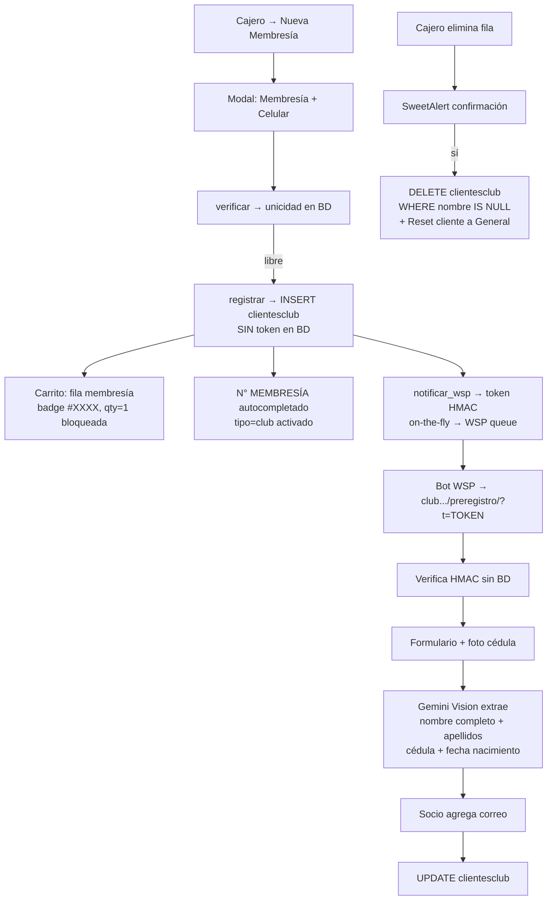

# 🌿 Club Pitaya — Lógica Completa en el POS (`facturas_nueva`)

> Análisis de todos los archivos que componen el flujo de Club Pitaya en la factura POS.
> **Última actualización: 2026-11-17** — se integró flujo de venta de Membresía.

---

## Archivos Involucrados

| Archivo | Rol |
|---|---|
| [`facturas_nueva.php`](file:///c:/Users/migue/Desktop/Sistema/Pitaya%20Web/VisualCode/pos.batidospitaya.com/modulos/pos/facturas_nueva.php) | HTML/PHP — Vista principal del POS |
| [`facturas_nueva.js`](file:///c:/Users/migue/Desktop/Sistema/Pitaya%20Web/VisualCode/pos.batidospitaya.com/modulos/pos/js/facturas_nueva.js) | JS — Lógica del frontend |
| [`membresia_club.js`](file:///c:/Users/migue/Desktop/Sistema/Pitaya%20Web/VisualCode/pos.batidospitaya.com/modulos/pos/js/membresia_club.js) | JS — Flujo de registro/eliminación de membresía nueva |
| [`membresia_club.css`](file:///c:/Users/migue/Desktop/Sistema/Pitaya%20Web/VisualCode/pos.batidospitaya.com/modulos/pos/css/membresia_club.css) | CSS — Estilos del botón, badge y fila de membresía |
| [`registrar_membresia_club.php`](file:///c:/Users/migue/Desktop/Sistema/Pitaya%20Web/VisualCode/pos.batidospitaya.com/modulos/pos/ajax/registrar_membresia_club.php) | AJAX — verificar / registrar / eliminar / notificar_wsp |
| [`cliente_club_buscar.php`](file:///c:/Users/migue/Desktop/Sistema/Pitaya%20Web/VisualCode/pos.batidospitaya.com/modulos/clientes/ajax/cliente_club_buscar.php) | AJAX — Busca el socio y calcula puntos actuales |
| [`cliente_historial_productos.php`](file:///c:/Users/migue/Desktop/Sistema/Pitaya%20Web/VisualCode/pos.batidospitaya.com/modulos/clientes/ajax/cliente_historial_productos.php) | AJAX — Historial paginado de compras del socio |
| [`facturas_guardar.php`](file:///c:/Users/migue/Desktop/Sistema/Pitaya%20Web/VisualCode/pos.batidospitaya.com/modulos/pos/ajax/facturas_guardar.php) | AJAX — Guarda la venta y registra puntos en BD |
| [`core/config/club_token_secret.php`](file:///c:/Users/migue/Desktop/Sistema/Pitaya%20Web/VisualCode/pos.batidospitaya.com/core/config/club_token_secret.php) | Config — Clave HMAC para tokens de preregistro (PitayaCore) |

---

## 1. Selección del Tipo de Cliente

En la columna derecha del POS hay dos radio buttons y el botón **Nueva Membresía** en el header del panel:

```
[ ○ CLUB PITAYA   ● CLIENTE GENERAL ]         [+ Nueva Membresía]
```

**Función JS:** `cambiarTipoCliente(tipo)`

- Si se selecciona **`general`**: oculta el campo de membresía, limpia el cliente, desactiva la barra de puntos, y **revierte todos los ítems canjeados** (los pone a precio normal).
- Si se selecciona **`club`**: muestra el campo N° MEMBRESÍA, muestra la barra de puntos (`#colIndicadoresPuntos`), y bloquea el campo de nombre (se llena automáticamente desde la búsqueda).

> [!IMPORTANT]
> La variable global `clienteActual` guarda el objeto del socio encontrado. Si es `null`, los toggles de canje están deshabilitados en la tabla.

---

## 2. Búsqueda del Socio Club Pitaya

### Frontend — `buscarClienteClub()`

Se activa de dos formas:
1. Presionar **Enter** en el campo `#membresiaCliente`
2. Clic en el botón lupa `#btnBuscarMembresia`

Si el botón de lupa se presiona y el cliente ya está cargado con ese número → abre directamente el **Modal Historial** sin volver a consultar.

**Endpoint:** `POST /modulos/clientes/ajax/cliente_club_buscar.php`

**Al encontrar al cliente:**
```js
clienteActual = res.cliente;
$('#nombreCliente').val(clienteActual.nombre_completo);
$('#idClienteClub').val(clienteActual.id_clienteclub);
$('#txtPuntosAnteriores').text(clienteActual.puntos_anteriores);
$('#clienteCheckVerificado').fadeIn();  // ✅ badge verde
actualizarPuntosFactura();
```

### Backend — `cliente_club_buscar.php`

**Query 1 — Datos del socio:**
```sql
SELECT id_clienteclub, membresia, nombre, apellido, nombre_sucursal, puntos_iniciales
FROM clientesclub
WHERE membresia = :membresia OR membresia = :membresia_int
LIMIT 1
```

**Query 2 — Puntos históricos Access (sistema legacy):**
```sql
SELECT COALESCE(SUM(
    CASE WHEN VentasGlobalesAccessCSV.Anulado = 0
         THEN (Cantidad * Puntos) ELSE 0 END
), 0) as total_puntos
FROM VentasGlobalesAccessCSV
LEFT JOIN DBBatidos ON CodProducto = CodBatido
WHERE CodCliente = :membresia
AND (CodGrupo IS NULL OR (CodGrupo != 25 AND CodGrupo != 11))
-- Excluye grupos 25 y 11 (membresias/no puntúan)
```

**Query 3 — Puntos del nuevo POS Web:**
```sql
SELECT COALESCE(SUM(puntos_ganados) - SUM(puntos_canjeados), 0) as saldo_nuevo
FROM pos_ventas_factura_puntos_club pfpc
JOIN pos_ventas_facturas pf ON pf.id = pfpc.id_factura
WHERE pfpc.id_cliente_club = :id_cliente AND pf.estado = 'bloqueada'
```

> [!NOTE]
> Los puntos se calculan en tres capas: puntos de arranque (`puntos_iniciales`), historial del sistema Access legacy (`VentasGlobalesAccessCSV`) y ventas del nuevo POS Web (`pos_ventas_factura_puntos_club`). Esto permite migración gradual.

---

## 3. Venta de Membresía Club Pitaya (NUEVO)

### Acceso
Botón **+ Nueva Membresía** en el header del panel "Tipo de Cliente" → abre `#modalNuevaMembresia`.

### Modal de Registro Rápido
Campos del modal:
- **N° MEMBRESÍA** — número de tarjeta física. Se verifica disponibilidad antes de continuar.
- **CELULAR** — 8 dígitos exactos (sin código de país). Se guarda así en BD.

### Flujo completo

```
1. Verificar unicidad → POST registrar_membresia_club.php {accion:'verificar'}
2. Registrar socio  → POST registrar_membresia_club.php {accion:'registrar'}
   - INSERT clientesclub (sucursal, membresia, celular, fecha_registro, puntos_iniciales=0, nombre_sucursal)
   - Nombre_sucursal: SELECT nombre FROM sucursales WHERE codigo = :cod
   - Precio: SELECT precio FROM pos_menu_precios WHERE id_catalogo_menu_pos = 13 (fallback C$99)
   - Token HMAC generado on-the-fly (NO se guarda en BD)
3. Agregar al carrito → _agregarItemMembresia(membresia, precio)
4. Autocompletar campo N° MEMBRESÍA + cambiarTipoCliente('club')
5. Notificar WSP  → POST registrar_membresia_club.php {accion:'notificar_wsp'}
   - Genera token HMAC: clubTokenGenerar(membresia)
   - URL: https://club.batidospitaya.com/preregistro/?t=TOKEN
   - INSERT wsp_notificaciones_clientesclub_pendientes_ (instancia='wsp-clientes')
```

### Producto de membresía en BD
- `catalogo_menu_pos.id = 13` → catálogo "Membresia"
- `producto_presentacion.id = 126` → "Tarjeta de membresia unid" (`activo='SI'`)
- Precio en `pos_menu_precios WHERE id_catalogo_menu_pos = 13`

### Render especial en la tabla del carrito

La línea de membresía se distingue visualmente:
```
[ Membresía Club Pitaya  #9872 ]  [🗑️]  [ - 1 + ]  C$ 99.00
                                           ↑ bloqueado
```
- Badge verde con `#NUMERO` a la derecha del nombre
- Botones `−` / `+` y el input deshabilitados (cantidad fija = 1)
- **Sin** botones ✏️ editar ni copiar
- Solo ícono 🗑️ que activa `_eliminarItemMembresia(idx)` con confirmación SweetAlert

### Eliminar membresía del carrito

Cuando el cajero elimina la línea:
1. SweetAlert de confirmación
2. `DELETE FROM clientesclub WHERE membresia = :m AND (nombre IS NULL OR nombre = '')` — solo borra si el socio no ha completado el preregistro
3. Reset tipo de cliente a "Cliente General" si coincide con el campo membresía activo

### Campo `membresia_venta` en BD
La columna `pos_ventas_factura_lineas.membresia_venta INT(11)` guarda el número de membresía para trazabilidad. Cuando la línea no es membresía, el valor es `NULL`.

### Restricciones del ítem membresía
- `bloquea_puntos = 1` → no acumula puntos
- `puntos_acumulacion = 0`
- Cantidad bloqueada en 1
- No se puede personalizar

---

## 4. Token de Preregistro — HMAC sin columna en BD

El socio recibe por WhatsApp una URL con token firmado para completar su perfil en `club.batidospitaya.com/preregistro/`.

**Mecanismo (stateless, sin columna adicional):**
```
Token = base64url( "MEMBRESIA:hmac_sha256(MEMBRESIA, SECRET)" )
```

- **Archivo:** `core/config/club_token_secret.php` (replicado por PitayaCore)
- **Generar:** `clubTokenGenerar(int $membresia): string`
- **Verificar:** `clubTokenVerificar(string $token): ?int` → membresía o `null`
- El mismo número de membresía siempre genera el mismo token → el link WSP es permanente

> [!CAUTION]
> Cambiar `CLUB_TOKEN_SECRET` invalida todos los links activos. Los socios tendrían que recibir un nuevo WSP.

---

## 5. Portal de Preregistro (`club.batidospitaya.com/preregistro/`)

Formulario público — no requiere sesión. Acceso solo con token HMAC válido.

### Archivos
| Archivo | Función |
|---|---|
| `preregistro/index.php` | Verifica token, muestra formulario o "ya completado" |
| `preregistro/ajax/analizar_cedula.php` | Recibe imagen → Gemini Vision → extrae datos cédula |
| `preregistro/ajax/completar_registro.php` | UPDATE clientesclub con nombre/apellido/cedula/fecha/correo |
| `preregistro/js/preregistro.js` | Lógica frontend: upload, análisis IA, guardar |
| `preregistro/css/preregistro.css` | Estilos mobile-first |

### Extracción de datos con IA
- Modelo: `gemini-2.0-flash` via `AIService($conn, 'google')`
- Imagen enviada como `inline_data` (base64) en `extraParts`
- El prompt extrae: **nombre completo** (todos los nombres), **apellido completo** (todos los apellidos), número de cédula (formato `NNN-DDMMAA-NNNNL`), fecha de nacimiento (YYYY-MM-DD desde los dígitos DDMMAA de la cédula)
- Campos extraídos: **solo lectura** en el formulario. Solo `correo` es editable manualmente.

### Seguridad del formulario
- Acceso: `?t=TOKEN` → si el token HMAC no es válido → HTTP 403
- Si `nombre` ya tiene valor en BD → muestra pantalla "ya completado" (idempotente)
- `UPDATE ... WHERE nombre IS NULL OR nombre = ''` → protege contra sobreescritura

---

## 6. Barra de Puntos en la Factura

Una vez cargado el socio, se muestra la barra compacta:

```
[ ANTERIORES: 120 ] [ ESTA FACTURA: +3 ] [ TOTAL PUNTOS: 123.00 ]
```

**Función JS:** `actualizarPuntosFactura()`

```js
// Puntos de esta factura = sum(cantidad) de ítems NO canjeados y NO membresía
const puntosEstaFactura = detalleFactura.reduce((s, d) =>
    s + (!d.es_canjeado && !d.bloquea_puntos ? (parseFloat(d.cantidad) || 0) : 0), 0);
```

**Regla de acumulación:** `1 punto por cada unidad vendida` (los ítems canjeados y la membresía no generan puntos).

---

## 7. Toggle "CANJEADO" por Producto

Columna **CANJEADO** en la tabla — switch CSS personalizado. Disponible solo para clientes Club verificados.

**Función:** `toggleCanjeadoItem(idx, checked)`

- `true` → `costo_total_iva = 0`, `es_canje_puntos = 1`, `bloquea_puntos = 1`
- `false` → restaura precio normal

> [!WARNING]
> Si el cajero cambia de **Club Pitaya** a **Cliente General** después de haber marcado canjes, el sistema **automáticamente revierte todos los canjes** y restaura los precios normales.

---

## 8. Guardar la Factura y Registrar Puntos

### Backend — `facturas_guardar.php` — Transacción con 4 pasos:

#### Paso 1 — Cabecera en `pos_ventas_facturas`
```sql
INSERT INTO pos_ventas_facturas
(cod_sucursal, cod_cajero, tipo_cliente, id_cliente_club,
 nombre_cliente_general, subtotal, propina, total, estado, fecha_hora)
VALUES (..., 'bloqueada', NOW())
```

#### Paso 2 — Líneas en `pos_ventas_factura_lineas`
```sql
INSERT INTO pos_ventas_factura_lineas
(id_factura, id_producto_presentacion, nombre_producto_snapshot,
 cantidad, precio_unitario_snap, precio_unitario_final, precio_linea_total,
 es_canje_puntos, notas, membresia_venta)
```
- `membresia_venta` = número de membresía si la línea es una venta de membresía, `NULL` en caso contrario
- `es_canje_puntos = 1` cuando el ítem fue canjeado (precio C$ 0.00)

#### Paso 3 — Pagos en `pos_ventas_factura_pagos`

#### Paso 4 — Registrar Puntos en `pos_ventas_factura_puntos_club`
```sql
INSERT INTO pos_ventas_factura_puntos_club
(id_factura, id_cliente_club, puntos_ganados, puntos_canjeados, observaciones)
-- puntos_ganados = SUM(cantidad) de ítems con bloquea_puntos = 0
```

> [!CAUTION]
> El campo `puntos_canjeados` se inserta en 0. El débito de puntos al canjear aún no está implementado — es una mejora futura.

---

## 9. Modal Historial del Cliente

Botón lupa → `abrirModalHistorial(membresia, pagina)`

**Endpoint:** `POST /modulos/clientes/ajax/cliente_historial_productos.php`

Tabla paginada (12 registros/página):
| Sucursal | Fecha/Hora | Producto/Medida | Cantidad | Promoción | Puntos Acum. |

---

## Flujo Completo — Venta con Membresía Nueva



---

## Resumen de Tablas BD Involucradas

| Tabla | Función |
|---|---|
| `clientesclub` | Datos del socio (nombre, apellido, cédula, membresía, celular, etc.) |
| `VentasGlobalesAccessCSV` | Historial legacy de ventas (Access) — fuente de puntos históricos |
| `DBBatidos` | Catálogo de productos legacy — filtra grupos 25 y 11 |
| `promociones_access_csv` | Nombres de promociones del sistema legacy |
| `pos_ventas_facturas` | Cabecera de facturas del nuevo POS |
| `pos_ventas_factura_lineas` | Detalle de líneas — incluye `es_canje_puntos`, `membresia_venta` |
| `pos_ventas_factura_pagos` | Métodos de pago registrados |
| `pos_ventas_factura_puntos_club` | Puntos ganados/canjeados por factura del nuevo POS |
| `pos_ventas_tipo_cambio` | Tipo de cambio USD/NIO vigente |
| `wsp_notificaciones_clientesclub_pendientes_` | Cola de mensajes WhatsApp (instancia=`wsp-clientes`) |
| `catalogo_menu_pos` | Catálogo de menú — id=13 es "Membresia" |
| `producto_presentacion` | Productos vendibles — id=126 es "Tarjeta de membresia unid" |
| `pos_menu_precios` | Precio por catálogo/sucursal — base membresía C$99 |
| `sucursales` | Nombre de sucursal para `clientesclub.nombre_sucursal` |
