# 🌿 Club Pitaya — Lógica Completa en el POS (`facturas_nueva`)

> Análisis de todos los archivos que componen el flujo de Club Pitaya en la factura POS.

---

## Archivos Involucrados

| Archivo | Rol |
|---|---|
| [`facturas_nueva.php`](file:///c:/Users/migue/Desktop/Sistema/Pitaya%20Web/VisualCode/pos.batidospitaya.com/modulos/pos/facturas_nueva.php) | HTML/PHP — Vista principal del POS |
| [`facturas_nueva.js`](file:///c:/Users/migue/Desktop/Sistema/Pitaya%20Web/VisualCode/pos.batidospitaya.com/modulos/pos/js/facturas_nueva.js) | JS — Toda la lógica del frontend |
| [`cliente_club_buscar.php`](file:///c:/Users/migue/Desktop/Sistema/Pitaya%20Web/VisualCode/pos.batidospitaya.com/modulos/clientes/ajax/cliente_club_buscar.php) | AJAX — Busca el socio y calcula puntos actuales |
| [`cliente_historial_productos.php`](file:///c:/Users/migue/Desktop/Sistema/Pitaya%20Web/VisualCode/pos.batidospitaya.com/modulos/clientes/ajax/cliente_historial_productos.php) | AJAX — Historial paginado de compras del socio |
| [`facturas_guardar.php`](file:///c:/Users/migue/Desktop/Sistema/Pitaya%20Web/VisualCode/pos.batidospitaya.com/modulos/pos/ajax/facturas_guardar.php) | AJAX — Guarda la venta y registra puntos en BD |

---

## 1. Selección del Tipo de Cliente

En la columna derecha del POS hay dos radio buttons:

```
○ CLUB PITAYA     ● CLIENTE GENERAL
```

**Función JS:** [`cambiarTipoCliente(tipo)`](file:///c:/Users/migue/Desktop/Sistema/Pitaya%20Web/VisualCode/pos.batidospitaya.com/modulos/pos/js/facturas_nueva.js#L110-L151)

- Si se selecciona **`general`**: oculta el campo de membresía, limpia el cliente, desactiva la barra de puntos, y **revierte todos los ítems canjeados** (los pone a precio normal).
- Si se selecciona **`club`**: muestra el campo N° MEMBRESÍA, muestra la barra de puntos (`#colIndicadoresPuntos`), y bloquea el campo de nombre (se llena automáticamente desde la búsqueda).

> [!IMPORTANT]
> La variable global `clienteActual` guarda el objeto del socio encontrado. Si es `null`, los toggles de canje están deshabilitados en la tabla.

---

## 2. Búsqueda del Socio Club Pitaya

### Frontend — [`buscarClienteClub()`](file:///c:/Users/migue/Desktop/Sistema/Pitaya%20Web/VisualCode/pos.batidospitaya.com/modulos/pos/js/facturas_nueva.js#L154-L221)

Se activa de dos formas:
1. Presionar **Enter** en el campo `#membresiaCliente`
2. Clic en el botón lupa `#btnBuscarMembresia`

Si el botón de lupa se presiona y el cliente ya está cargado con ese número → abre directamente el **Modal Historial** sin volver a consultar.

**Endpoint:** `POST /modulos/clientes/ajax/cliente_club_buscar.php`
**Parámetro:** `membresia`

**Al encontrar al cliente:**
```js
clienteActual = res.cliente;
$('#nombreCliente').val(clienteActual.nombre_completo);
$('#idClienteClub').val(clienteActual.id_clienteclub);
$('#txtPuntosAnteriores').text(clienteActual.puntos_anteriores); // ← puntos actuales
$('#clienteCheckVerificado').fadeIn();  // ✅ badge verde
actualizarPuntosFactura();
```

### Backend — [`cliente_club_buscar.php`](file:///c:/Users/migue/Desktop/Sistema/Pitaya%20Web/VisualCode/pos.batidospitaya.com/modulos/clientes/ajax/cliente_club_buscar.php)

**Query 1 — Datos del socio:**
```sql
SELECT id_clienteclub, membresia, nombre, apellido, nombre_sucursal, puntos_iniciales
FROM clientesclub
WHERE membresia = :membresia OR membresia = :membresia_int
LIMIT 1
```

**Query 2 — Puntos históricos Access (sistema legacy):**
```sql
SELECT COALESCE(SUM(
    CASE WHEN VentasGlobalesAccessCSV.Anulado = 0
         THEN (Cantidad * Puntos) ELSE 0 END
), 0) as total_puntos
FROM VentasGlobalesAccessCSV
LEFT JOIN DBBatidos ON CodProducto = CodBatido
WHERE CodCliente = :membresia
AND (CodGrupo IS NULL OR (CodGrupo != 25 AND CodGrupo != 11))
-- Excluye grupos 25 y 11 (membresias/no puntúan)
```

**Query 3 — Puntos del nuevo POS Web:**
```sql
SELECT COALESCE(SUM(puntos_ganados) - SUM(puntos_canjeados), 0) as saldo_nuevo
FROM pos_ventas_factura_puntos_club pfpc
JOIN pos_ventas_facturas pf ON pf.id = pfpc.id_factura
WHERE pfpc.id_cliente_club = :id_cliente AND pf.estado = 'bloqueada'
```

**Resultado devuelto:**
```php
$totalPuntos = $puntosIniciales + $puntosAccess + $puntosNuevos;
// → campo 'puntos_anteriores' en la respuesta JSON
```

> [!NOTE]
> Los puntos se calculan en tres capas: puntos de arranque (`puntos_iniciales`), historial del sistema Access legacy (`VentasGlobalesAccessCSV`) y ventas del nuevo POS Web (`pos_ventas_factura_puntos_club`). Esto permite migración gradual.

---

## 3. Barra de Puntos en la Factura

Una vez cargado el socio, se muestra la barra compacta:

```
[ ANTERIORES: 120 ] [ ESTA FACTURA: +3 ] [ TOTAL PUNTOS: 123.00 ]
```

**Función JS:** [`actualizarPuntosFactura()`](file:///c:/Users/migue/Desktop/Sistema/Pitaya%20Web/VisualCode/pos.batidospitaya.com/modulos/pos/js/facturas_nueva.js#L354-L369)

```js
// Puntos de esta factura = sum(cantidad) de ítems NO canjeados
const puntosEstaFactura = detalleFactura.reduce((s, d) =>
    s + (!d.es_canjeado ? (parseFloat(d.cantidad) || 0) : 0), 0);

const puntosAnteriores = parseFloat(clienteActual.puntos_anteriores) || 0;
const totalPuntos = Math.round((puntosAnteriores + puntosEstaFactura) * 100) / 100;
```

**Regla de acumulación:** `1 punto por cada unidad vendida` (los ítems canjeados no generan puntos).

Se re-ejecuta automáticamente:
- Al agregar/quitar productos
- Al activar/desactivar el toggle de canjeado
- Al cambiar cantidad de un ítem
- Al finalizar el cálculo del total (`actualizarTotal()`)

---

## 4. Toggle "CANJEADO" por Producto

Columna **CANJEADO** en la tabla de productos — es un switch CSS personalizado.

```html
<label class="switch-canje-pos [switch-canje-deshabilitado]">
  <input type="checkbox" [checked] [disabled] onchange="toggleCanjeadoItem(idx, this.checked)">
  <span class="slider-canje-pos"></span>
</label>
```

**El toggle está deshabilitado** (`disabled` + clase `switch-canje-deshabilitado`) cuando:
- El tipo de cliente es `general`, o
- No hay un `id_cliente_club` válido, o
- `clienteActual` es null

### Función [`toggleCanjeadoItem(idx, checked)`](file:///c:/Users/migue/Desktop/Sistema/Pitaya%20Web/VisualCode/pos.batidospitaya.com/modulos/pos/js/facturas_nueva.js#L666-L701)

```js
function toggleCanjeadoItem(idx, checked) {
    // Validación: solo cliente club verificado puede canjear
    if (checked && !esClubValido) {
        actualizarTablaDetalle(); // revierte visualmente
        Swal.fire({ title: 'Cliente Club Requerido', ... });
        return;
    }

    const item = detalleFactura[idx];
    item.es_canjeado = checked;

    if (checked) {
        item.costo_total_iva = 0;       // ← precio a C$ 0.00
        item.es_canje_puntos = 1;
        item.bloquea_puntos = 1;        // ← no genera puntos
    } else {
        // Restaurar precio normal
        item.costo_total_iva = Math.round(item.cantidad * item.precio_unitario * 100) / 100;
        item.es_canje_puntos = 0;
        item.bloquea_puntos = 0;
    }

    actualizarTablaDetalle(); // → re-renderiza + recalcula puntos y total
}
```

**Efecto visual cuando `es_canjeado = true`:**
```html
<!-- Precio tachado en rojo + C$ 0.00 en verde -->
<del class="precio-tachado-canje">C$ 45.00</del>
<strong class="precio-cero-canje">C$ 0.00</strong>
<!-- La fila completa recibe clase CSS: fila-canjeada -->
```

**Efecto en la barra de puntos:**
- El ítem canjeado se excluye del conteo `puntosEstaFactura`
- El total a pagar no incluye el precio de ese ítem

> [!WARNING]
> Si el cajero cambia de **Club Pitaya** a **Cliente General** después de haber marcado canjes, el sistema **automáticamente revierte todos los canjes** y restaura los precios normales.

---

## 5. Cálculo del Subtotal con Canjeados

**Función [`calcularSubtotalFactura()`](file:///c:/Users/migue/Desktop/Sistema/Pitaya%20Web/VisualCode/pos.batidospitaya.com/modulos/pos/js/facturas_nueva.js#L751-L758):**

```js
return detalleFactura.reduce(function (s, d) {
    if (d.es_canjeado) return s; // ya vale 0, no suma al subtotal
    var base = parseFloat(d.costo_total_iva) || 0;
    var dto  = parseFloat(d.descuento_promo)  || 0;
    return s + Math.max(0, Math.round((base - dto) * 100) / 100);
}, 0);
```

Los ítems canjeados **no suman al subtotal**, pero sí aparecen en la tabla de la factura con precio C$ 0.00 para auditoría.

---

## 6. Guardar la Factura y Registrar Puntos

### Frontend → Backend

```js
$.post('/modulos/pos/ajax/facturas_guardar.php', {
    tipo_cliente:    'club',
    id_cliente_club: idClienteClub,
    nombre_cliente:  clienteActual.nombre_completo,
    detalle:         JSON.stringify(detalleFactura),  // incluye es_canjeado, es_canje_puntos
    pagos:           JSON.stringify(pagos),
    total:           totalFactura
}, ...);
```

### Backend — [`facturas_guardar.php`](file:///c:/Users/migue/Desktop/Sistema/Pitaya%20Web/VisualCode/pos.batidospitaya.com/modulos/pos/ajax/facturas_guardar.php)

Se ejecuta en **transacción** con 4 pasos:

#### Paso 1 — Cabecera en `pos_ventas_facturas`
```sql
INSERT INTO pos_ventas_facturas
(cod_sucursal, cod_cajero, tipo_cliente, id_cliente_club,
 nombre_cliente_general, subtotal, propina, total, estado, fecha_hora)
VALUES (..., 'bloqueada', NOW())
```

#### Paso 2 — Líneas en `pos_ventas_factura_lineas`
```sql
INSERT INTO pos_ventas_factura_lineas
(id_factura, id_producto_presentacion, nombre_producto_snapshot,
 cantidad, precio_unitario_snap, precio_extras_total,
 precio_unitario_final, precio_linea_total, es_canje_puntos, notas)
```
- `es_canje_puntos = 1` cuando el ítem fue canjeado (precio C$ 0.00)
- La personalización se serializa en el campo `notas`: `[PRODUCTO CANJEADO (Puntos) | Endulzante: Miel | Sin: Fresa]`
- El backend re-valida `esCanjeado`: solo acepta canje si `tipo_cliente = 'club'` y hay `id_cliente_club`

#### Paso 3 — Pagos en `pos_ventas_factura_pagos`
Registra cada método (efectivo, POS, transferencia, cupón).

#### Paso 4 — **Registrar Puntos Ganados** en `pos_ventas_factura_puntos_club`
```php
// totalPuntosGanados = SUM(cantidad) de TODOS los ítems del detalle
// (incluyendo los canjeados — se acumula la cantidad bruta)
$totalPuntosGanados += $cantidad;

// Solo si es socio Club Pitaya
if ($tipoCliente === 'club' && $idClienteClub && $totalPuntosGanados > 0) {
    INSERT INTO pos_ventas_factura_puntos_club
    (id_factura, id_cliente_club, puntos_ganados, puntos_canjeados, observaciones)
    VALUES (:id_fac, :id_cliente, :ganados, 0.00, 'Venta POS Web')
}
```

> [!CAUTION]
> El campo `puntos_canjeados` se inserta en 0. **Actualmente no se descuentan los puntos de la cuenta del socio al momento del canje** — el canje solo marca el precio a C$ 0.00 visualmente, pero no hay un mecanismo de débito de puntos en la transacción. Esto puede requerir implementación futura.

---

## 7. Modal Historial del Cliente

Botón lupa → abre [`abrirModalHistorial(membresia, pagina)`](file:///c:/Users/migue/Desktop/Sistema/Pitaya%20Web/VisualCode/pos.batidospitaya.com/modulos/pos/js/facturas_nueva.js#L227-L315)

**Endpoint:** `POST /modulos/clientes/ajax/cliente_historial_productos.php`

Muestra tabla paginada (12 registros/página) con:
| Sucursal | Fecha/Hora | Producto/Medida | Cantidad | Promoción | Puntos Acum. |
|---|---|---|---|---|---|

La columna **Puntos Acum.** va en orden decreciente cronológico: el saldo va bajando conforme se recorre el historial.

---

## 8. Quick Add Membresía Club Pitaya

Botón **QUICK ADD** en el banner lateral izquierdo:

```js
$('#btnQuickAddMembresia').on('click', function () {
    // Activa automáticamente modo Club Pitaya si está en General
    $('#tipoClienteClub').prop('checked', true);
    cambiarTipoCliente('club');

    // Agrega al ticket un ítem virtual de membresía
    detalleFactura.unshift({
        id_presentacion: -1,           // ← ID virtual negativo
        nombre: 'Membresía Club Pitaya',
        precio_unitario: 150,
        costo_total_iva: 150,
        cantidad: 1,
        notas: 'Ingresar número de membresía'
    });
});
```

> [!NOTE]
> La membresía usa `id_presentacion = -1` (virtual). El backend tiene validación `if ($idPresentacion <= 0) throw new Exception(...)`, lo que implica que este ítem virtual generará un error al guardar. Probablemente necesita un `id_presentacion` real de BD para producción.

---

## Flujo Completo — Diagrama

```mermaid
flowchart TD
    A["Cajero abre facturas_nueva.php"] --> B["Selecciona ● CLUB PITAYA"]
    B --> C["Escribe N° membresía\n#membresiaCliente"]
    C --> D["Enter o clic lupa 🔍"]
    D --> E["POST cliente_club_buscar.php"]
    E --> F{"¿Encontrado?"}
    F -- No --> G["❌ SweetAlert error\nclienteActual = null"]
    F -- Sí --> H["clienteActual = res.cliente\nNombre, ID, puntos_anteriores"]
    H --> I["✅ Badge verificado visible\nBarra de puntos aparece"]
    I --> J["ANTERIORES: 120 | ESTA FACTURA: +0 | TOTAL: 120"]
    J --> K["Cajero agrega productos al carrito"]
    K --> L["actualizarPuntosFactura()\nEsta Factura += cantidad del ítem"]
    L --> M["ESTA FACTURA: +3 | TOTAL: 123"]
    M --> N{"¿Activar Toggle CANJEADO?"}
    N -- Sí --> O["toggleCanjeadoItem(idx, true)\nitem.costo_total_iva = 0\nitem.es_canje_puntos = 1"]
    O --> P["Precio tachado + C$ 0.00\nEsta Factura -= cantidad del ítem canjeado"]
    P --> Q["calcularSubtotalFactura()\nExcluye ítems canjeados del total"]
    N -- No --> Q
    Q --> R["Cajero selecciona método de pago\nEfectivo / POS / Transferencia / Cupón"]
    R --> S["btnGuardar → guardarFactura()"]
    S --> T["POST facturas_guardar.php\ndetalle JSON con es_canjeado, es_canje_puntos"]
    T --> U["BD: BEGIN TRANSACTION"]
    U --> V["INSERT pos_ventas_facturas\nestado = 'bloqueada'"]
    V --> W["INSERT pos_ventas_factura_lineas\nes_canje_puntos = 1 si canjeado\nprecio_linea_total = 0 si canjeado"]
    W --> X["INSERT pos_ventas_factura_pagos"]
    X --> Y["INSERT pos_ventas_factura_puntos_club\npuntos_ganados = SUM(cantidades)\npuntos_canjeados = 0"]
    Y --> Z["COMMIT ✅\n¡Venta guardada!"]
    Z --> AA["Reset completo del POS\nNueva venta lista"]
```



---

## Resumen de Tablas BD Involucradas

| Tabla | Función |
|---|---|
| `clientesclub` | Datos del socio (nombre, membresía, puntos_iniciales) |
| `VentasGlobalesAccessCSV` | Historial legacy de ventas (Access) — fuente de puntos históricos |
| `DBBatidos` | Catálogo de productos legacy — filtra grupos 25 y 11 |
| `promociones_access_csv` | Nombres de promociones del sistema legacy |
| `pos_ventas_facturas` | Cabecera de facturas del nuevo POS |
| `pos_ventas_factura_lineas` | Detalle de líneas — incluye `es_canje_puntos` |
| `pos_ventas_factura_pagos` | Métodos de pago registrados |
| `pos_ventas_factura_puntos_club` | Puntos ganados/canjeados por factura del nuevo POS |
| `pos_ventas_tipo_cambio` | Tipo de cambio USD/NIO vigente |
